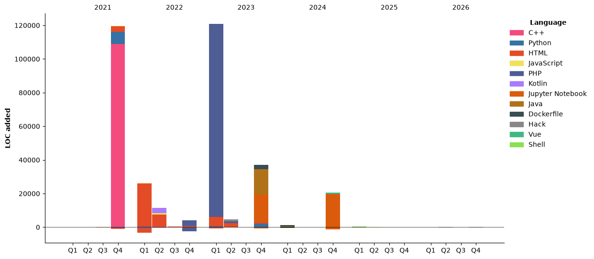

# Hi there 👋

<!--
**NTX8205/NTX8205** is a ✨ _special_ ✨ repository because its `README.md` (this file) appears on your GitHub profile.

Here are some ideas to get you started:

- 🔭 I’m currently working on ...
- 🌱 I’m currently learning ...
- 👯 I’m looking to collaborate on ...
- 🤔 I’m looking for help with ...
- 💬 Ask me about ...
- 📫 How to reach me: ...
- 😄 Pronouns: ...
- ⚡ Fun fact: ...
-->

## Certificate

<a href="https://www.credly.com/badges/ab23bad5-d229-433a-8af7-0b57f31250de/public_url"></a>
<a href="https://www.credly.com/badges/faf87566-e8dc-43b7-8ae9-bd1192c2c210/public_url"></a>

## Code status

<!--START_SECTION:waka-->


**🐱 My GitHub Data** 

> 📦 165.9 kB Used in GitHub's Storage 
 > 
> 🏆 33 Contributions in the Year 2026
 > 
> 🚫 Not Opted to Hire
 > 
> 📜 19 Public Repositories 
 > 
> 🔑 18 Private Repositories 
 > 
**I'm an Early 🐤** 

```text
🌞 Morning                121 commits         ██████░░░░░░░░░░░░░░░░░░░   22.96 % 
🌆 Daytime                173 commits         ████████░░░░░░░░░░░░░░░░░   32.83 % 
🌃 Evening                145 commits         ███████░░░░░░░░░░░░░░░░░░   27.51 % 
🌙 Night                  88 commits          ████░░░░░░░░░░░░░░░░░░░░░   16.70 % 
```
📅 **I'm Most Productive on Thursday** 

```text
Monday                   39 commits          ██░░░░░░░░░░░░░░░░░░░░░░░   07.40 % 
Tuesday                  91 commits          ████░░░░░░░░░░░░░░░░░░░░░   17.27 % 
Wednesday                72 commits          ███░░░░░░░░░░░░░░░░░░░░░░   13.66 % 
Thursday                 151 commits         ███████░░░░░░░░░░░░░░░░░░   28.65 % 
Friday                   67 commits          ███░░░░░░░░░░░░░░░░░░░░░░   12.71 % 
Saturday                 59 commits          ███░░░░░░░░░░░░░░░░░░░░░░   11.20 % 
Sunday                   48 commits          ██░░░░░░░░░░░░░░░░░░░░░░░   09.11 % 
```


📊 **This Week I Spent My Time On** 

```text
🕑︎ Time Zone: Asia/Taipei

💬 Programming Languages: 
Python                   4 mins              ████████████████░░░░░░░░░   65.03 % 
SSH Config               1 min               ████████░░░░░░░░░░░░░░░░░   30.78 % 
YAML                     0 secs              █░░░░░░░░░░░░░░░░░░░░░░░░   04.19 % 

🔥 Editors: 
VS Code                  6 mins              █████████████████████████   100.00 % 

💻 Operating System: 
Windows                  6 mins              █████████████████████████   100.00 % 
```

🤖 **AI Coding This Week** 

```text
No AI Coding Activity Tracked This Week
```

**I Mostly Code in Python** 

```text
Python                   8 repos             ██████░░░░░░░░░░░░░░░░░░░   25.81 % 
Jupyter Notebook         2 repos             ██░░░░░░░░░░░░░░░░░░░░░░░   06.45 % 
Shell                    1 repo              █░░░░░░░░░░░░░░░░░░░░░░░░   03.23 % 
Vue                      1 repo              █░░░░░░░░░░░░░░░░░░░░░░░░   03.23 % 
Dockerfile               1 repo              █░░░░░░░░░░░░░░░░░░░░░░░░   03.23 % 
```


**Timeline**




 Last Updated on 06/11/2026 23:21:24 UTC
<!--END_SECTION:waka-->
